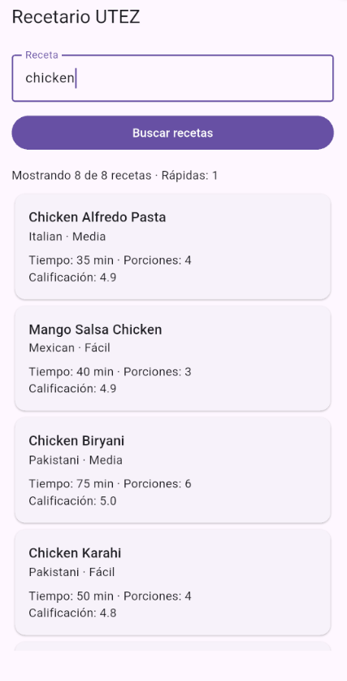
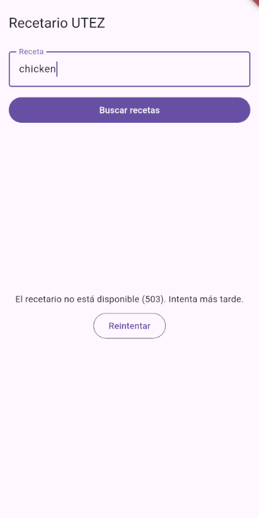
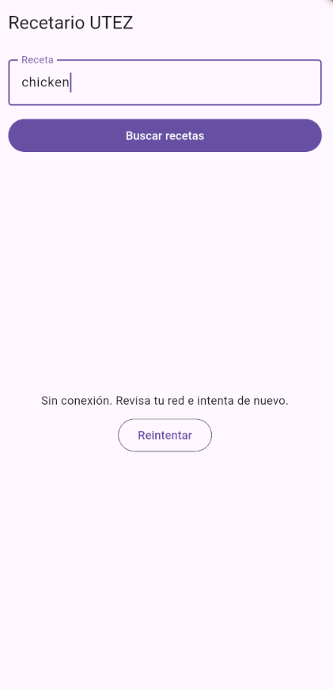
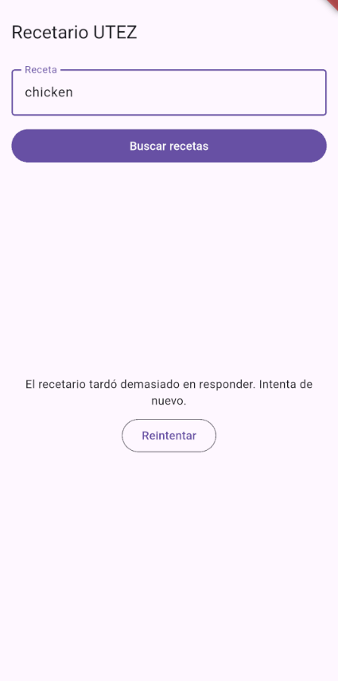

# Evidencias — Recetario UTEZ

**Nombre:** Laura Lizet Perez Bosques
**Matrícula:** 20233TN113
**Fecha:** 03/11/2026
**Dispositivo donde se probó:** emulador Android

## 1. Del JSON a Dart

| JSON | Campo Dart | Tipo | Regla (obligatorio, tolerado, valor por defecto) |
|---|---|---|---|
| `recipes` | `PaginaRecetas.recetas` | `List<Receta>` | Obligatorio: debe ser lista de objetos; si no, `FormatException` |
| `total` | `PaginaRecetas.total` | `int` | Obligatorio |
| `id` | `Receta.id` | `int` | Obligatorio |
| `name` | `Receta.nombre` | `String` | Obligatorio |
| `cuisine` | `Receta.cocina` | `String` | Obligatorio |
| `difficulty` | `Receta.dificultad` | `Dificultad` | Tolerado: `Easy`/`Medium`/`Hard`; cualquier otro valor o ausente → `Dificultad.desconocida` ("Sin dato") |
| `prepTimeMinutes` | `Receta.minutosPreparacion` | `int` | Obligatorio |
| `cookTimeMinutes` | `Receta.minutosCoccion` | `int` | Obligatorio |
| `servings` | `Receta.porciones` | `int` | Obligatorio |
| `rating` | `Receta.calificacion` | `double` | Obligatorio; llega como `num` y se convierte con `.toDouble()` (puede venir `5` o `4.44`) |
| `tags` | `Receta.etiquetas` | `List<String>` | Opcional: ausente/`null` → `[]`; si no es lista de textos → `FormatException` |
| `ingredients` | `Receta.ingredientes` | `List<String>` | Opcional: ausente/`null` → `[]`; si no es lista de textos → `FormatException` |

## 2. Escenarios probados con el servicio real

| Escenario | Cómo lo provoqué | Qué vio la persona | Línea de la bitácora | Captura | Prueba del kit que lo cubre |
|---|---|---|---|---|---|
| Éxito | Busqué `chicken` | Encabezado "Mostrando 8 de 8 recetas · Rápidas: 1" y una tarjeta por receta | `← 200 GET /recipes/search (1256 ms)` |  | `etapa3`: "200 → PaginaRecetas"; `etapa5`: "texto + botón → indicador y botón apagado → tarjetas" |
| Vacío | Busqué `zzzz` | `No encontramos recetas para "zzzz".` (sin botón Reintentar) | `← 200 GET /recipes/search (1047 ms)` |  | `etapa3`: "200 sin resultados → página vacía"; `etapa4`: "sin resultados → Vacias"; `etapa5`: "vacío con texto dice qué se buscó…" |
| Error del servidor | Cambio temporal A en `main.dart` (`o.path = '/http/503'`) y busqué `chicken` | `El recetario no está disponible (503). Intenta más tarde.` y botón Reintentar | `✗ badResponse 503 GET /http/503 (1310 ms)` |  | `etapa3`: "503 → ErrorDelServidor(503)"; `etapa4`: "FallaRed → Fallidas con el mensaje de mensajePara" |
| Sin red | Apagué Wi-Fi y datos del emulador (`adb shell svc wifi disable` / `svc data disable`) y busqué `chicken` | `Sin conexión. Revisa tu red e intenta de nuevo.` y botón Reintentar | `✗ connectionError GET /recipes/search (159 ms)` |  | `etapa3`: "sin red → SinConexion"; `etapa5`: "error → mensaje y Reintentar repite la misma búsqueda" |
| Tiempo agotado | Cambio temporal B en `main.dart` (`delay=5000`, timeouts de 2 s) y busqué `chicken` | `El recetario tardó demasiado en responder. Intenta de nuevo.` y botón Reintentar | `✗ receiveTimeout GET /recipes/search (2635 ms)` |  | `etapa3`: "receiveTimeout → TiempoAgotado" y "connectTimeout → TiempoAgotado"; `etapa4`: `mensajePara(TiempoAgotado)` |

## 3. Preguntas de reflexión

1. **¿En qué se diferencian el escenario "Error del servidor" y "Sin red" desde el punto de vista de HTTP?**
   En el 503 el servidor sí contestó: hubo respuesta HTTP con un código. Sin red nunca hubo respuesta, la petición ni siquiera llegó. Por eso la app muestra mensajes distintos.

2. **¿Por qué "Vacío" no es un error?**
   Porque todo salió bien: el servidor respondió 200, solo que no había recetas que coincidieran. No hay nada que reintentar.

3. **La búsqueda de la persona viaja en la query. ¿Por qué tu bitácora no la escribe?**
   Porque es lo que la persona escribió y no tiene por qué quedar guardado en un registro. La bitácora usa solo la ruta (`options.path`), sin el `?q=...`.

4. **Si DummyJSON cambiara `rating` por `score`, ¿qué archivos tendrías que modificar y por qué solo esos?**
   Solo `recetas_json.dart`, que es donde se traduce el JSON a `Receta`. El resto de la app usa `Receta.calificacion` y no se entera del cambio.
